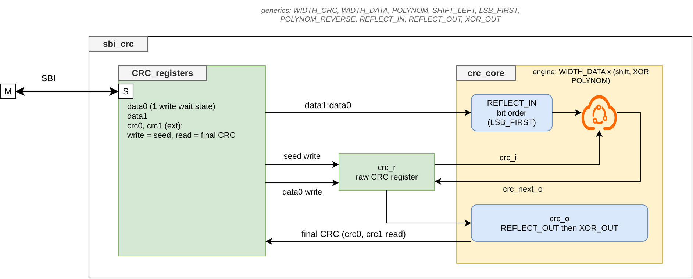
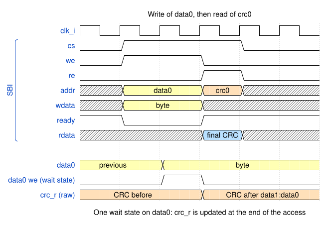

<!--
  README MODEL (common to every Asylum IP, keep the same headings)
  ----------------------------------------------------------------
  Regenerate from the sources, never from the previous README text alone:
    hdl/*.vhd (entities, generics, ports), hdl/csr/*.hjson (register map),
    <IP>.core (VLNV, targets, depends), mk/targets.txt, sim/, syn/, esw/.
  Sections, in this order:
    badges / title + one-line pitch / Overview / Features / Block Diagram /
    Getting Started / Hardware Interfaces / Configuration / Resources /
    Theory of Operation / Registers / Programmer's Guide /
    Design Verification / Dependencies and Related IPs / License
  Rules:
    - English, short and factual: every statement backed by the sources.
    - No VLNV line: the version badge shows it.
    - Badges: first line version, license; second line CI, lint, sim, syn.
    - Block diagram and FSM: pages Overview and FSM of doc/<NAME>.drawio, exported to
      doc/<NAME>-Overview.png and doc/<NAME>-FSM.png (make -C doc).
    - Timing diagrams: WaveDrom source doc/<NAME>-<what>.json, rendered
      doc/<NAME>-<what>.svg (make -C doc), shown as images.
    - No CPU named (OpenBlaze, PicoBlaze, RISC-V) outside the CPU and SoC IPs.
    - Registers: link to the generated hdl/csr/<X>_csr.md, never copy the tables.
    - Tables: Configuration = Name|Type|Default|Description,
      Hardware Interfaces = Name|Direction|Type|Description, grouped by interface.
    - A section with nothing to say is one line ("This IP has no
      software-visible registers."), never removed.
-->
[](https://github.com/deuskane/asylum-component-crc/tags)
[](LICENSE)

[](https://github.com/deuskane/asylum-component-crc/actions/workflows/ci.yml)
[](https://github.com/deuskane/asylum-component-crc/actions/workflows/ci.yml)
[](https://github.com/deuskane/asylum-component-crc/actions/workflows/ci.yml)
[](https://github.com/deuskane/asylum-component-crc/actions/workflows/ci.yml)

# CRC

**A small, readable CRC calculator in VHDL: any polynomial up to 16 bits, one data word per bus write, results equal to the CRC catalogue, verified against a reference model on 10 standard CRCs.**

Part of the [Asylum project](https://github.com/deuskane/asylum-project), a collection of small IP cores, written to be read and learned from.

## Table of Contents

1. [Overview](#overview)
2. [Features](#features)
3. [Block Diagram](#block-diagram)
4. [Getting Started](#getting-started)
5. [Hardware Interfaces](#hardware-interfaces)
6. [Configuration](#configuration)
7. [Resources](#resources)
8. [Theory of Operation](#theory-of-operation)
9. [Registers](#registers)
10. [Programmer's Guide](#programmers-guide)
11. [Design Verification](#design-verification)
12. [Dependencies and Related IPs](#dependencies-and-related-ips)
13. [License](#license)

## Overview

This IP computes a CRC in hardware, one data word per bus write. Software writes the seed in `crc1:crc0`, then each data word in `data1:data0` (`data1` only for words wider than 8 bits); the write of `data0` updates the CRC register. A read of `crc1:crc0` returns the final CRC of the words processed so far.

The CRC engine, `crc_core`, is combinational: it processes a whole data word in one cycle. Its polynomial, widths, shift direction, bit order, reflections and output XOR are generics, so the same core computes the usual non-reflected and reflected CRCs (Rocksoft model of the CRC catalogue). It can also be used on its own, without the registers.

## Features

- CRC width `WIDTH_CRC` and data word width `WIDTH_DATA` up to 16 bits each (`crc_core` alone has no limit)
- Any polynomial (`POLYNOM`, implicit MSB not included), optionally bit-reversed (`POLYNOM_REVERSE`)
- Shift left (MSB feedback) or right (LSB feedback) (`SHIFT_LEFT`), data bits MSB or LSB first (`LSB_FIRST`)
- Input and output reflection (`REFLECT_IN`, `REFLECT_OUT`) and output XOR mask (`XOR_OUT`), applied on the read path only: multi-word messages give the catalogue value
- One data word per write of `data0`, one wait state: the very next access reads the new CRC
- Software-writable CRC register (seed, the catalogue `Init`)
- Default polynomial per width (`crc_default_polynom`): CRC-8/SMBUS (8 bits), CRC-16/XMODEM (16 bits), CRC-32/MPEG-2 (32 bits, `crc_core` only)

## Block Diagram



## Getting Started

The cores of the Asylum IPs are published in the FuseSoC library [asylum-cores](https://github.com/deuskane/asylum-cores) (with the UVVM core used by the testbench):

```bash
pip install fusesoc
fusesoc library add https://github.com/deuskane/asylum-cores
fusesoc run --target sim_crc16_x25_check_value asylum:component:crc  # needs GHDL
```

To use the IP in your design, add `asylum:component:crc` to the `depend` list of your core and instantiate `sbi_crc` (library `asylum`). CRC-16/CCITT-FALSE (polynomial 0x1021, MSB first, no reflection, seed 0xFFFF written by software):

```vhdl
library asylum;
use     asylum.sbi_pkg.all;
use     asylum.crc_pkg.all;

  ins_crc : sbi_crc
    generic map
    ( NAME            => "CRC0"
     ,WIDTH_CRC       => 16
     ,WIDTH_DATA      => 8
     ,POLYNOM         => x"1021"
     ,SHIFT_LEFT      => true
     ,LSB_FIRST       => false
     ,POLYNOM_REVERSE => false
     ,REFLECT_IN      => false
     ,REFLECT_OUT     => false
     ,XOR_OUT         => x"0000"
    )
    port map
    ( clk_i     => clk
     ,arst_b_i  => arst_b
     ,sbi_ini_i => sbi_ini       -- 2 address bits, 8-bit data
     ,sbi_tgt_o => sbi_tgt
    );
```

## Hardware Interfaces

Top-level entity: **`sbi_crc`** ([hdl/sbi_crc.vhd](hdl/sbi_crc.vhd)), component in `asylum.crc_pkg`.

### Clock and Reset

| Name | Direction | Type | Description |
|------|-----------|------|-------------|
| `clk_i` | in | std_logic | System clock, the only clock of the IP |
| `arst_b_i` | in | std_logic | Asynchronous reset, active low |

### Bus (SBI)

| Name | Direction | Type | Description |
|------|-----------|------|-------------|
| `sbi_ini_i` | in | sbi_ini_t | Request from the initiator (`cs`, `re`, `we`, `addr`, `wdata`); 2 address bits, 8-bit data |
| `sbi_tgt_o` | out | sbi_tgt_t | Response to the initiator (`ready`, `rdata`, `info`) |

<details>
<summary><b>crc_core</b>: combinational CRC engine, for a standalone use without the registers</summary>

[hdl/crc_core.vhd](hdl/crc_core.vhd), component in `asylum.crc_pkg`. Same generics as `sbi_crc` except `NAME`, without the 16-bit limit. Feed `crc_next_o` back to `crc_i` through a register, read the result on `crc_o`.

| Name | Direction | Type | Description |
|------|-----------|------|-------------|
| `d_i` | in | std_logic_vector(WIDTH_DATA-1 downto 0) | Data word |
| `crc_i` | in | std_logic_vector(WIDTH_CRC-1 downto 0) | Current CRC register (raw) |
| `crc_next_o` | out | std_logic_vector(WIDTH_CRC-1 downto 0) | CRC register after `d_i` (raw: no `REFLECT_OUT`, no `XOR_OUT`) |
| `crc_o` | out | std_logic_vector(WIDTH_CRC-1 downto 0) | Final CRC of `crc_i`: reflected if `REFLECT_OUT`, then XORed with `XOR_OUT` |

</details>

## Configuration

Generics of `sbi_crc`:

| Name | Type | Default | Description |
|------|------|---------|-------------|
| `NAME` | string | `""` | Instance name, visible in `sbi_tgt_o.info` |
| `WIDTH_CRC` | positive | `16` | CRC width, <= 16 (assertion) |
| `WIDTH_DATA` | positive | `8` | Data word width, <= 16 (assertion): `data1:data0` |
| `POLYNOM` | std_logic_vector(WIDTH_CRC-1 downto 0) | `crc_default_polynom(WIDTH_CRC)` | Polynomial without the implicit MSB. Default `x"07"` for 8 bits, `x"1021"` for 16 bits; other widths must set it (failure at elaboration) |
| `SHIFT_LEFT` | boolean | `true` | `true`: shift left, feedback from the MSB; `false`: shift right, feedback from the LSB |
| `LSB_FIRST` | boolean | `false` | `true`: data bits processed LSB first; `false`: MSB first |
| `POLYNOM_REVERSE` | boolean | `false` | `true`: the bit-reversed `POLYNOM` is used |
| `REFLECT_IN` | boolean | `false` | `true`: data word bit-reversed before processing |
| `REFLECT_OUT` | boolean | `false` | `true`: CRC bit-reversed on the read path |
| `XOR_OUT` | std_logic_vector(WIDTH_CRC-1 downto 0) | `(others => '0')` | XOR mask of the CRC on the read path, after `REFLECT_OUT` |

`crc_core` warns at elaboration for `SHIFT_LEFT = false` with the data MSB first (`LSB_FIRST = false`, `REFLECT_IN = false`): this only gives a CRC of the catalogue with a reflected polynomial, a reflected seed and `REFLECT_OUT`.

## Resources

Figures of the `syn_*` targets (`make nonreg_syn`, see [Targets](#targets)): [syn/sbi_crc_wrapper.vhd](syn/sbi_crc_wrapper.vhd) with the generics of each configuration, synthesized by Yosys and its GHDL plugin; the reports are in the build directory of each target. The wrapper has its own defaults: `POLYNOM = x"1021"`, `SHIFT_LEFT = false`, the other generics as `sbi_crc`.

| Configuration | LUT¹ | LUTRAM¹ | FF¹ | CARRY4¹ | MUXF7/F8¹ | BRAM¹ | DSP¹ | Area² (µm²) | kGE³ |
|---|---|---|---|---|---|---|---|---|---|
| `syn_default` (16 bits, polynomial 0x1021, shift right, MSB first) | 77 | 0 | 33 | 0 | 4 | 0 | 0 | 1751.68 | 0.467 |
| `syn_crc8_smbus` (CRC-8/SMBUS) | 52 | 0 | 25 | 0 | 0 | 0 | 0 | 1333.78 | 0.355 |
| `syn_crc16_modbus` (CRC-16/MODBUS, shift right, LSB first) | 74 | 0 | 33 | 0 | 4 | 0 | 0 | 1742.92 | 0.464 |
| `syn_crc16_arc_right` (CRC-16/ARC, shift right, `POLYNOM_REVERSE`, `REFLECT_IN`) | 74 | 0 | 33 | 0 | 4 | 0 | 0 | 1742.92 | 0.464 |
| `syn_crc5_usb` (CRC-5/USB, `REFLECT_IN`, `REFLECT_OUT`, `XOR_OUT`) | 47 | 0 | 22 | 0 | 2 | 0 | 0 | 1144.85 | 0.305 |
| `syn_crc16_data16` (16 bits, `WIDTH_DATA` 16, shift left) | 83 | 0 | 33 | 0 | 6 | 0 | 0 | 2003.17 | 0.534 |

¹ Xilinx Artix-7 (LUT6), Yosys 0.33 `synth_xilinx -flatten -noiopad -noclkbuf`, before place and route: every cell of the netlist is counted, Vivado may differ. An `INV` counts as a `LUT1`: `synth_xilinx` puts one on the reset pin of each flip-flop with the active-low reset (34 of the 77 LUTs of `syn_default`). The IP has no memory: no LUTRAM, no BRAM. Flip-flops: `data0` and `data1` (16), the CRC register (`WIDTH_CRC`), the wait state of `data0` (1).

² SkyWater sky130 `sky130_fd_sc_hd`, typical corner (tt, 25 °C, 1.80 V), Yosys 0.33 `synth` + `dfflibmap` + `abc -liberty`: standard-cell area only, no timing constraint, no buffering, clock tree or placement.

³ Area in thousands of NAND2 gate equivalents (`sky130_fd_sc_hd__nand2_1` = 3.7536 µm²).

## Theory of Operation

### Hierarchy

| File | Unit | Role |
|------|------|------|
| [hdl/sbi_crc.vhd](hdl/sbi_crc.vhd) | `sbi_crc` | Top level: registers, raw CRC register `crc_r`, `crc_core` |
| [hdl/crc_core.vhd](hdl/crc_core.vhd) | `crc_core` | Combinational CRC engine (architecture `combi_based`) |
| [hdl/crc_pkg.vhd](hdl/crc_pkg.vhd) | `crc_pkg` | Components, default polynomial `crc_default_polynom` |
| `hdl/csr/crc_csr.vhd` | `CRC_registers` | Register bank, generated by regtool from [hdl/csr/crc.hjson](hdl/csr/crc.hjson) |

### Algorithm

`crc_core` unrolls the bit-serial CRC on the `WIDTH_DATA` bits of the word (after `REFLECT_IN`, in the order set by `LSB_FIRST`):

- `SHIFT_LEFT = true`: `fb = crc(MSB) xor d(bit)`, `crc = (crc << 1) xor (fb ? POLY : 0)`
- `SHIFT_LEFT = false`: `fb = crc(0) xor d(bit)`, `crc = (crc >> 1) xor (fb ? POLY : 0)`

with `POLY = POLYNOM`, or its bit-reversed value when `POLYNOM_REVERSE = true`. The result `crc_next_o` is the raw register; the final CRC `crc_o` is the raw register reflected (`REFLECT_OUT`), then XORed with `XOR_OUT`.

Usual settings (each one simulated, see [Design Verification](#design-verification)):

| Convention | `SHIFT_LEFT` | `LSB_FIRST` | `POLYNOM_REVERSE` | `REFLECT_IN` | `REFLECT_OUT` | Seed |
|------------|--------------|-------------|-------------------|--------------|---------------|------|
| Non-reflected (CRC-16/CCITT-FALSE, poly 0x1021) | `true` | `false` | `false` | `false` | `false` | catalogue `Init` |
| Reflected, catalogue style (CRC-16/ARC, X-25) | `true` | `false` | `false` | `true` | `true` | catalogue `Init` |
| Reflected, shift right (CRC-16/MODBUS: `POLYNOM = 0xA001`) | `false` | `true` | `false` | `false` | `false` | reflected `Init` |
| Reflected, shift right (CRC-16/ARC: `POLYNOM = 0x8005`) | `false` | `false` | `true` | `true` | `false` | reflected `Init` |

### CRC register

`sbi_crc` keeps the raw CRC register `crc_r` (16 bits, the `WIDTH_CRC` low bits are used):

- a write of `crc0` / `crc1` loads its low / high byte (the seed);
- a write of `data0` loads `crc_next_o` of `data1:data0` (the `WIDTH_DATA` low bits) and `crc_r`. `data0` has one write wait state: the register `data0` is written in the first cycle of the access, `crc_r` is updated in the second one, so the next access reads the new CRC;
- a read of `crc0` / `crc1` returns `crc_o`, the final CRC of `crc_r`; the bits above `WIDTH_CRC` read 0.

`REFLECT_OUT` and `XOR_OUT` are only applied on the read path, never fed back: a CRC over any number of words matches the catalogue. The reset value of `crc_r` is 0, so `crc1:crc0` read `XOR_OUT` after a reset.



A write of `crc0` / `crc1` and the update of a `data0` write never happen in the same cycle (the bus does one access at a time); if they did, the software write would win.

## Registers

Four 8-bit registers (2 address bits): `data0` (0x0), `data1` (0x1), `crc0` (0x2), `crc1` (0x3). `crc0` / `crc1` are external registers (`hwtype: ext`): a write sets the raw CRC register, a read returns the final CRC.

- Register documentation: **[hdl/csr/crc_csr.md](hdl/csr/crc_csr.md)**
- C header: [hdl/csr/crc_csr.h](hdl/csr/crc_csr.h)
- Source: [hdl/csr/crc.hjson](hdl/csr/crc.hjson) (regtool)

## Programmer's Guide

1. Write the seed (catalogue `Init`, reflected for a shift-right configuration) in `crc0` (bits 7:0) and `crc1` (bits 15:8).
2. For each data word: write `data1` (bits 15:8, only when `WIDTH_DATA > 8`), then `data0`. With `WIDTH_DATA = 8`, write `data0` only.
3. Read `crc0` and `crc1`: the final CRC, `REFLECT_OUT` and `XOR_OUT` applied.

No polling is needed: the write of `data0` lasts until the CRC is updated. To continue later from a CRC read with `REFLECT_OUT` / `XOR_OUT`, undo them (XOR with `XOR_OUT`, then reflect) before writing it back as the seed.

### Example: CRC-16 of a buffer

The registers are 8 bits wide, at consecutive byte addresses from the base address of the IP (`0x40002000` is an example, use the address map of your SoC). Configuration CRC-16/CCITT-FALSE of [Getting Started](#getting-started): seed 0xFFFF, `crc16(buf, 9)` of `"123456789"` returns 0x29B1.

```c
#include <stddef.h>
#include <stdint.h>
#include "crc_csr.h"

#define CRC_BASE ((uintptr_t)0x40002000u)   // example base address

static inline void reg_wr(uint32_t offset, uint8_t data)
{
  *(volatile uint8_t *)(CRC_BASE + offset) = data;
}

static inline uint8_t reg_rd(uint32_t offset)
{
  return *(volatile uint8_t *)(CRC_BASE + offset);
}

uint16_t crc16(const uint8_t *buf, size_t n)
{
  reg_wr(CRC_CRC0, 0xFF);                     // seed 0xFFFF
  reg_wr(CRC_CRC1, 0xFF);

  for (size_t i = 0; i < n; i++)
    reg_wr(CRC_DATA0, buf[i]);                // one byte per write (WIDTH_DATA = 8)

  return (uint16_t)(reg_rd(CRC_CRC0) | (reg_rd(CRC_CRC1) << 8));
}
```

## Design Verification

### Testbench

| File | DUT | Description |
|------|-----|-------------|
| [sim/crc/tb_crc.vhd](sim/crc/tb_crc.vhd) | `sbi_crc` | Self-checking UVVM testbench with the SBI BFM, generics `TESTS_LIST` (scenarios, see below) and `CFG` (configuration of the DUT, a CRC of the catalogue). Three `crc_core` instances without bus run next to it: default generics with 16 and 8 bits, and `REFLECT_OUT` with `XOR_OUT = 0x00FF` (not a palindrome: the order REFLECT_OUT then XOR_OUT is visible). Scenarios in `tb_crc_<name>_pkg`, names and dispatch in [tb_crc_tests_pkg](sim/crc/tb_crc_tests_pkg.vhd), helpers (register accesses with at most one wait state, seed, data word, CRC check, reset pulse) in [tb_crc_bfm_pkg](sim/crc/tb_crc_bfm_pkg.vhd) |
| [sim/crc/tb_crc_pkg.vhd](sim/crc/tb_crc_pkg.vhd) | - | Table `C_CRC_CFG` of the configurations, each one a CRC of the catalogue (Rocksoft parameters and check value of `"123456789"`), and a bit-serial Rocksoft reference model, independent of `crc_core` |

Every CRC read from the DUT is compared with the reference model, itself checked against the catalogue check value.

| `CFG` | CRC | `SHIFT_LEFT` | `LSB_FIRST` | `POLYNOM_REVERSE` | `REFLECT_IN` | `REFLECT_OUT` | `XOR_OUT` | Seed | Check |
|-------|-----|--------------|-------------|-------------------|--------------|---------------|-----------|------|-------|
| 0 | CRC-8/SMBUS, `POLYNOM = 0x07` | true | false | false | false | false | 0x00 | 0x00 | 0xF4 |
| 1 | CRC-8/I-432-1, `POLYNOM = 0x07` | true | false | false | false | false | 0x55 | 0x00 | 0xA1 |
| 2 | CRC-16/CCITT-FALSE, `POLYNOM = 0x1021` | true | false | false | false | false | 0x0000 | 0xFFFF | 0x29B1 |
| 3 | CRC-16/GENIBUS, `POLYNOM = 0x1021` | true | false | false | false | false | 0xFFFF | 0xFFFF | 0xD64E |
| 4 | CRC-16/ARC, `POLYNOM = 0x8005` | true | false | false | true | true | 0x0000 | 0x0000 | 0xBB3D |
| 5 | CRC-16/X-25, `POLYNOM = 0x1021` (reference) | true | false | false | true | true | 0xFFFF | 0xFFFF | 0x906E |
| 6 | CRC-16/MODBUS, `POLYNOM = 0xA001` | false | true | false | false | false | 0x0000 | 0xFFFF | 0x4B37 |
| 7 | CRC-16/ARC, `POLYNOM = 0x8005` | false | false | true | true | false | 0x0000 | 0x0000 | 0xBB3D |
| 8 | CRC-5/USB, `WIDTH_CRC = 5`, `POLYNOM = 0x05` | true | false | false | true | true | 0x1F | 0x1F | 0x19 |
| 9 | CRC-16/XMODEM, `WIDTH_DATA = 16`, `POLYNOM = 0x1021` | true | false | false | false | false | 0x0000 | 0x0000 | model only |

Seed: catalogue `Init` (the DUT is seeded with its reflection for `CFG` 6 and 7). Not simulated: `WIDTH_CRC` or `WIDTH_DATA` above 16 (rejected by an assertion of `sbi_crc`), `crc_core` alone above 16 bits.

### Scenarios (`TESTS_LIST`)

The scenarios are chosen at run time with the generic `TESTS_LIST`: names separated by `,` without space (`random,latency,random`), a name may be repeated. The sequencer first checks every name (an unknown name is a `TB_ERROR` before any scenario runs), then for each scenario drives a reset pulse with the bus inactive, logs `TEST <i>/<N> : <name>` and runs it: each scenario starts from reset and seeds the DUT itself. The empty list (default) only compiles and elaborates the testbench. The list is parsed and its names checked with `list_length` / `list_item` / `list_contains` of `asylum.string_pkg` (`asylum:utils:pkg` >= 1.10.0).

Checks counted as the `=> OK` lines of the log, with the reference configuration CRC-16/X-25 (`CFG` 5); the same with the other configurations, except `check_value` with `CFG` 9 (9 checks: 4 words of 16 bits, no catalogue value).

| Name | Checks | Description |
|------|--------|-------------|
| `core_default` | 4 | `crc_core` alone: default generics give the check values of CRC-16/XMODEM (0x31C3) and, with `WIDTH_CRC = 8`, CRC-8/SMBUS (0xF4); `crc_o` applies `REFLECT_OUT` then `XOR_OUT` |
| `reset_values` | 4 | `data0`, `data1` reset to 0; `crc1:crc0` read the final CRC of 0 (`XOR_OUT`) |
| `register_access` | 10 | `data0` / `data1` read back; random values written in `crc1:crc0` read back as their final CRC, bits above `WIDTH_CRC` read 0 |
| `check_value` | 21 | Reference model against the catalogue check value; DUT seeded with the catalogue `Init`, CRC after each byte of `"123456789"` and catalogue check value |
| `latency` | 4 | The access just after the `data0` write reads the new CRC (data word chosen to change `crc0`) |
| `seed_after_data` | 2 | CRC byte written just after a `data0` write: the update of `data0` is kept, the write overwrites its byte (`crc1`, above `WIDTH_CRC`, for the 8-bit and 5-bit CRCs) |
| `random` | 64 | 32 random messages of 1 to 16 words, random seed; random bits above `WIDTH_CRC` in the seed and above `WIDTH_DATA` in the data; for 8-bit data, `data1` written before the first word only |
| `async_reset` | 6 | Reset pulse between two rising edges of the clock: `data0`, `data1` and the CRC register back to their reset values |

The testbench was validated with 25 RTL mutants (scratch copies of `crc_core`, `sbi_crc` and `crc.hjson`), each run scenario by scenario in the 10 configurations: 24 are killed; the last one swaps the priority between a software write of `crc0` / `crc1` and the update of `data0`, two events that never happen in the same cycle (equivalent mutant).

### Targets

| Target | Toplevel | Description |
|--------|----------|-------------|
| `default` | `sbi_crc` | HDL fileset + CSR generation (not a simulation) |
| `sim_crc16_x25` | `tb_crc` | Reference configuration CRC-16/X-25 (`CFG=5`): build and elaboration only (`TESTS_LIST` empty) |
| `sim_crc16_x25_<name>` | `tb_crc` | One target per scenario with CRC-16/X-25: `sim_crc16_x25_core_default`, `_reset_values`, `_register_access`, `_check_value`, `_latency`, `_seed_after_data`, `_random`, `_async_reset` (115 checks in all) |
| `sim_<crc>` | `tb_crc` | One target per other configuration, every scenario: `sim_crc8_smbus`, `sim_crc8_i432`, `sim_crc16_ccitt_false`, `sim_crc16_genibus`, `sim_crc16_arc`, `sim_crc16_modbus`, `sim_crc16_arc_shift_right`, `sim_crc5_usb` (115 checks each), `sim_crc16_xmodem_data16` (103 checks) |
| `lint_ghdl` | `asylum.sbi_crc_wrapper` | GHDL `-Wall` analysis and elaboration of [syn/sbi_crc_wrapper.vhd](syn/sbi_crc_wrapper.vhd) |
| `lint_ghdl_synth_<config>` | `asylum.sbi_crc_wrapper` | `ghdl --synth` check for 6 generic configurations: `default`, `crc8_smbus`, `crc16_modbus`, `crc16_arc_right`, `crc5_usb`, `crc16_data16` |
| `syn_<config>` | `asylum.sbi_crc_wrapper` | Synthesis with Yosys, Artix-7 and sky130 (see [Resources](#resources)), same 6 configurations as `lint_ghdl_synth_<config>` |

The reference configuration (CRC-16/X-25: `REFLECT_IN`, `REFLECT_OUT`, `XOR_OUT` and a non-zero seed) has a build-only base target and one target per scenario: one CI job per scenario, a failure is isolated. Every other configuration has one target that runs the whole list: the `TEST <i>/<N>` header names a failing scenario. FuseSoC replaces the `parameters` list of an inherited target, so each target repeats `CFG`.

Every `sim_*`, `lint_*` and `syn_*` target is a job of the [GitHub CI](https://github.com/deuskane/asylum-component-crc/actions/workflows/ci.yml), run in the [asylum-env](https://github.com/deuskane/asylum-ci) image (GHDL, FuseSoC, UVVM, Yosys). The `sim`, `lint` and `syn` badges count the passed and failed targets of the last run on `main`.

### How to Run

From a clone of [asylum-project](https://github.com/deuskane/asylum-project) (GHDL and FuseSoC installed, or in the asylum-env image):

```bash
make help                        # variables, rules and targets
make sim_crc16_x25_random        # one scenario, log in log/
make sim_crc16_modbus            # every scenario of a configuration
make nonreg_sim                  # every sim_* target
make nonreg_lint                 # every lint_* target
make nonreg_syn                  # every syn_* target (Yosys, figures of Resources)
make TARGETS_FILTER=^sim_crc16_x25 nonreg_sim
```

To run a list of scenarios, or another configuration, build the testbench once, then run without recompiling, with FuseSoC (same `--build-root` and `--no-export` as the Makefile, so that the build of the target is reused; any generic of the target can be overridden after the VLNV):

```bash
make sim_crc16_x25               # build and elaboration (TESTS_LIST empty)
fusesoc --cores-root . run --build-root build --no-export --run --target sim_crc16_x25 asylum:component:crc:1.2.0 --TESTS_LIST=latency,random --CFG=8
```

or in the build directory of the target. `EXTRA_OPTIONS` replaces every generic set by the target: repeat `CFG`, else its default value (2) applies:

```bash
cd build/asylum_component_crc_1.2.0/sim_crc16_x25-ghdl
make run EXTRA_OPTIONS="-gTESTS_LIST=latency,random -gCFG=5"
```

To add a scenario: a `tb_crc_<name>_pkg` package (in the `sim` fileset of [crc.core](crc.core)), its name in `C_TESTS` and its case in `run_test` of [tb_crc_tests_pkg](sim/crc/tb_crc_tests_pkg.vhd), a `sim_crc16_x25_<name>` target and the name in the `TESTS_LIST` of the other configurations, then `make mk/targets.txt` and `make ci_generate`. To add a configuration: an entry of `C_CRC_CFG` (increase `C_NB_CFG`) and a `sim_<crc>` target.

Outside the CI, GHDL writes a waveform `dut.fst`.

## Dependencies and Related IPs

| Core | Repository | Purpose |
|------|------------|---------|
| `asylum:utils:generators` (>= 2.10.0) | [asylum-utils-generators](https://github.com/deuskane/asylum-utils-generators) | regtool (register generator) and the CSR building blocks (`csr_reg` with write wait states, `csr_ext`) |
| `asylum:utils:pkg` | [asylum-utils-pkg](https://github.com/deuskane/asylum-utils-pkg) | Common packages (`sbi_pkg`, `logic_pkg`: `mux2`, `reverse_bits`); the testbench needs >= 1.10.0 (`string_pkg` lists of `TESTS_LIST`) |
| `asylum:utils:ghdl_synth` | [asylum-utils-generators](https://github.com/deuskane/asylum-utils-generators) | `ghdl --synth` check of the `lint_ghdl_synth_*` targets |
| `asylum:utils:yosys_synth` | [asylum-utils-generators](https://github.com/deuskane/asylum-utils-generators) | Yosys synthesis of the `syn_*` targets (Artix-7 and sky130) |
| `bitvis:verification:uvvm` | [UVVM](https://github.com/UVVM/UVVM) | Verification library and SBI BFM |

Used by [asylum-soc-picosoc](https://github.com/deuskane/asylum-soc-picosoc) (CRC-16/MODBUS). All the IPs: [asylum-project](https://github.com/deuskane/asylum-project).

## License

Apache License 2.0, see [LICENSE](LICENSE).
